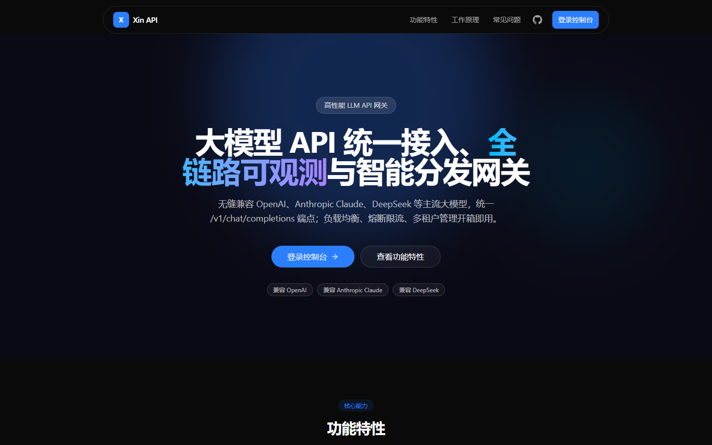
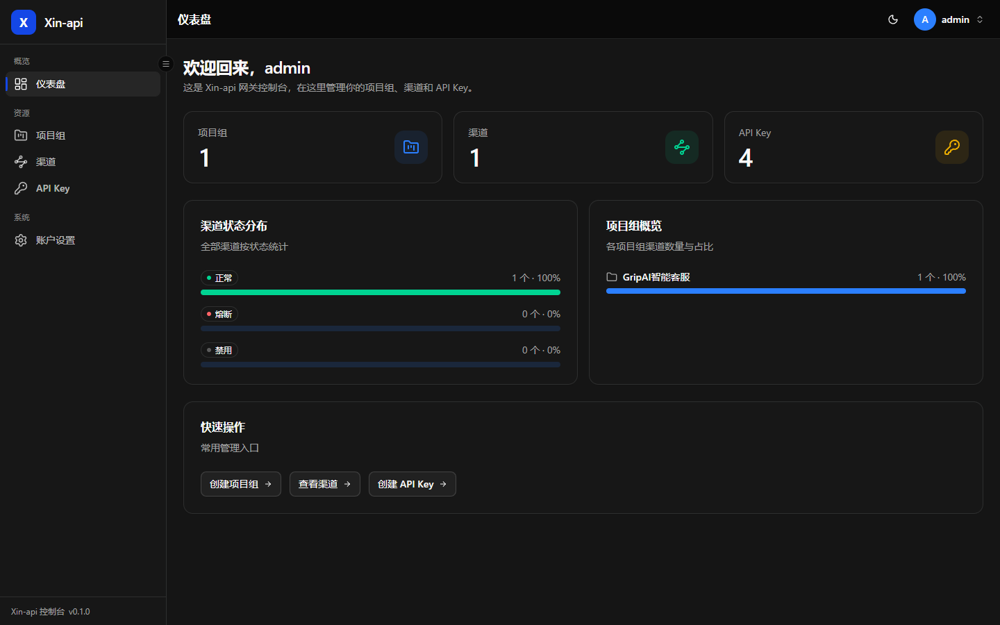

# Xin API 🚀

[English](./README.en.md) | 中文

<p align="center">
  <strong>集大模型 API 统一管理、全链路追踪、智能分发于一体的高性能网关服务</strong>
</p>

<p align="center">
  
  
  
  
  
  
  
</p>

---

## ✨ 项目简介

Xin API 是一个高性能的大语言模型（LLM）网关服务，无缝兼容 OpenAI、Anthropic Claude、DeepSeek、Gemini 等主流大模型，提供统一 API 接入、渠道路由、计费结算与可观测能力。

### 核心特性

- **🎯 统一 API 接入**: 数据面同时提供 `/v1/chat/completions`、`/v1/responses`、`/v1/messages`（Anthropic Messages 兼容）、`/v1beta/models/{model}:generateContent` 四种入站协议端点，统一路由到上游供应商
- **🔀 智能分发**: 按「优先级 + 同级加权轮询」选路，失败自动重试并排除已失败渠道
- **🛡️ 熔断保护**: 基于 Redis 的分布式被动熔断，连续失败达到阈值后自动隔离渠道，并按恢复间隔探测恢复
- **⚡ 限流能力（预留）**: 已实现基于 Redis 的令牌桶限流中间件，当前版本尚未挂载到数据面，`rpm_limit` / `tpm_limit` 暂未生效
- **👥 统一渠道管理**: 集中管理上游供应商渠道，配置权重、优先级与状态，并支持渠道级「模型管理」（增删改、启用/禁用、从上游拉取模型）
- **🗂️ 模型管理**: 以逻辑模型名为维度聚合展示各渠道的可用模型，支持跨渠道批量新增、编辑与启用/禁用
- **🔁 模型名映射**: 按「渠道 × 对外模型名」登记上游真实模型名，转发时自动改写为上游名、响应回写对外名
- **🧩 多协议适配**: 入站支持 OpenAI Chat、OpenAI Responses、Anthropic Messages、Gemini 原生协议；出站按渠道供应商适配 OpenAI / DeepSeek / Anthropic / Gemini
- **💰 计费与结算**: 价格方案支持 USD / CNY 计价，按配置汇率折算为 CNY 结算，并记录余额变动与汇率快照
- **🔑 API Key 管理**: 灵活的 API Key 分发和吊销机制
- **🧪 渠道健康检测**: 手动一键测试渠道状态，支持单渠道/批量测试多模型连通性
- **📋 全链路日志**: 请求日志、账单日志与审计日志，可选落库请求/响应原文（默认关闭）
- **📈 渠道指标聚合**: 60 秒窗口聚合成功率、TTFT、延迟、TPOT、RPM/TPM，启动自动回填最近 7 天
- **🌐 Web 管理后台**: 基于 React 19 + Tailwind CSS 的现代化管理界面
- **🐳 容器化部署**: 开箱即用的 Docker Compose 部署方案

---

## 🏗️ 技术架构

### 技术栈

| 层级 | 技术 |
|------|------|
| **前端** | React 19 + TypeScript + Vite + Tailwind CSS + Radix UI + Zustand |
| **后端** | Go 1.25 + Gin 1.12 + GORM + JWT |
| **数据库** | PostgreSQL 16（元数据存储，启动时 AutoMigrate 建表） |
| **缓存** | Redis 7（渠道查询缓存、熔断状态） |
| **代理** | Nginx（反向代理、SSE 透传） |
| **部署** | Docker + Docker Compose |

---

## 🚀 快速开始

### 环境要求

- Go 1.25+
- Node.js 22+（前端 `engines` 要求 `^20.19.0 || >=22.12.0`）
- PostgreSQL 16+
- Redis 7+
- Docker & Docker Compose（推荐）

### Docker Compose 一键部署（推荐）

```bash
# 1. 克隆项目
git clone https://github.com/GripAIcn/Xin-api.git
cd Xin-api

# 2. 配置环境变量（Compose 读取 build/.env）
cp .env.example build/.env
# 编辑 build/.env 修改数据库密码、Redis 密码、JWT 密钥等

# 3. 构建并启动服务
cd build
docker compose up -d --build

# 4. 访问服务
# Web 管理后台: http://localhost
# API 地址: http://localhost/v1
```

首次启动时后端会自动创建数据库、执行 GORM `AutoMigrate` 建表，并创建默认管理员账号 `admin / 12345678`，登录后请立即修改密码。

### 本地开发部署

#### 1. 启动依赖服务

```bash
# 启动 PostgreSQL 和 Redis
docker run -d --name xin-postgres \
  -e POSTGRES_PASSWORD=123456 \
  -p 5432:5432 \
  postgres:16-alpine

docker run -d --name xin-redis \
  -e REDIS_PASSWORD=123456 \
  -p 6379:6379 \
  redis:7-alpine
```

#### 2. 启动后端服务

```bash
# 配置环境变量（需与上面启动的 PostgreSQL / Redis 密码一致）
cp .env.example .env

# 安装依赖并运行
go mod download
go run ./cmd/xin_api/main.go
```

#### 3. 启动前端开发服务

```bash
cd web
npm install
npm run dev
```

前端开发服务器默认运行在 `http://localhost:5173`，开发模式已允许跨域访问后端。

---

## 🔧 配置说明

### 环境变量

| 变量 | 默认值 | 说明 |
|------|--------|------|
| `PROXY_PORT` | `8080` | 后端服务端口 |
| `GATEWAY_NODE` | 主机名 | 网关实例标识，落库 `request_logs.gateway_node` |
| `GIN_MODE` | `release`（`.env.example`） | Gin 运行模式（debug/release） |
| `LOG_LEVEL` | `info` | 预留，当前代码未读取 |
| `POSTGRES_HOST` | `127.0.0.1` | PostgreSQL 主机 |
| `POSTGRES_USER` | `root` | PostgreSQL 用户名 |
| `POSTGRES_PASSWORD` | 空 | PostgreSQL 密码（Compose 默认 `123456`） |
| `POSTGRES_DB` | `gateway` | 数据库名，不存在时启动自动创建 |
| `POSTGRES_PORT` | `5432` | PostgreSQL 端口 |
| `REDIS_HOST` | `127.0.0.1` | Redis 主机 |
| `REDIS_PORT` | `6379` | Redis 端口 |
| `REDIS_PASSWORD` | 空 | Redis 密码（Compose 默认 `123456`） |
| `REDIS_DB` | `0` | Redis 数据库编号 |
| `REDIS_POOL_SIZE` | `20` | Redis 连接池大小 |
| `JWT_SECRET` | `xin-api-default-secret-key-2026` | JWT 签名密钥（生产务必更换） |
| `JWT_EXPIRE` | `24h` | JWT 过期时间 |
| `CB_FAILURE_THRESHOLD` | `5` | 熔断连续失败阈值 |
| `CB_RECOVERY_INTERVAL` | `60s` | 熔断恢复探测间隔 |
| `CACHE_CHANNEL_EXPIRE` | `300s` | 渠道缓存过期时间 |
| `LOG_REQUEST_BODY` | `false` | 是否落库请求原文到 `request_payloads` |
| `LOG_RESPONSE_BODY` | `false` | 是否落库响应原文（流式响应最多保留 1 MiB） |
| `PROXY_REQUEST_TIMEOUT` | `120s` | 上游首字节（响应头）超时 / 非流式读取总超时 |
| `PROXY_MAX_BODY_MB` | `10` | 最大请求体大小（MB） |
| `PROXY_STREAM_KEEPALIVE_INTERVAL` | `15s` | 下游 SSE 空闲保活间隔（`0` 禁用） |
| `PROXY_STREAM_IDLE_TIMEOUT` | `300s` | 流式上游静默上限，超时主动结束流（`0` 禁用） |
| `USD_CNY_RATE` | `7.2` | USD→CNY 初始结算汇率（仅首次写入 `exchange_rates`） |
| `NGINX_HTTP_PORT` | `80` | Nginx HTTP 端口（仅 Compose 使用） |
| `NGINX_HTTPS_PORT` | `443` | Nginx HTTPS 端口（仅 Compose 使用） |
| `DEFAULT_RPM` | `60` | 预留，当前未生效 |
| `DEFAULT_TPM` | `100000` | 预留，当前未生效 |

---

## 🌐 在线演示

访问 [http://api.gripai.cn/](http://api.gripai.cn/) 体验 Xin API 管理后台

- **账号**：admin
- **密码**：12345678

---

## 📸 界面预览

### 官网首页



### 控制台仪表盘



### 管理后台功能

- **📊 仪表盘**: 请求量 / 成功率 / Token 用量 / 费用 / 平均延迟总览（支持今日、近 7 天、近 30 天切换），含请求量、Token、费用趋势图与模型、渠道、错误排行
- **🔑 API Key 管理**: 分发、查看和吊销当前用户的 API Key
- **📋 请求日志**: 按时间、用户、模型、渠道、状态、日志类型等维度筛选，查看单条请求的计费明细
- **🧾 账单日志**: 消费 / 充值 / 退款合并视图，支持分页与多维过滤
- **👤 账户与余额**: 查看个人资料与余额，修改邮箱/手机号与登录密码
- **👥 用户管理**（管理员）: 创建账号、启用/禁用、重置密码、为用户充值
- **🔌 渠道管理**（管理员）: 配置上游大模型渠道、优先级与权重、一键测试渠道连通性，并支持渠道级模型管理（增删改、启用/禁用、从上游拉取模型）
- **🗂️ 模型管理**（管理员）: 按逻辑模型名聚合查看全部渠道模型，支持跨渠道新增/编辑、启用/禁用
- **📈 渠道监控**（管理员）: 按渠道 / 模型维度查看成功率、TTFT、延迟、TPOT、RPM/TPM 等聚合指标与趋势图（每分钟增量聚合，启动自动回填最近 7 天）
- **💰 定价管理**（管理员）: 维护价格方案（USD/CNY 计价）与模型绑定，配置 USD→CNY 结算汇率

---

## 🐳 生产部署

### Docker Compose 部署

完整的部署配置请参考 [build/README.md](build/README.md)

部署目录结构：

```
build/
├── Dockerfile                   # 前后端统一多阶段构建（Node.js + Go + Alpine）
├── Dockerfile.nginx             # Nginx 反向代理镜像
├── docker-compose.yml           # 服务编排（PostgreSQL + Redis + App + Nginx）
├── .dockerignore                # build/ 目录构建忽略规则
├── nginx/                       # Nginx 配置文件
│   ├── nginx.conf
│   └── default.conf.template    # 站点模板（启动时注入 PROXY_PORT）
└── README.md                    # 部署说明
```

启动命令：

```bash
cd build

# 准备环境变量（首次部署）
cp ../.env.example .env

# 构建并启动所有服务
docker compose up -d --build

# 查看服务状态
docker compose ps

# 查看应用日志
docker compose logs -f app

# 停止服务
docker compose down
```

### 服务架构

```
用户请求 → Nginx (80/443)
    ├── /v1/*      → 后端 API 服务 (app:8080)
    ├── /v1beta/*  → Gemini 兼容接口 (app:8080)
    └── /*         → 前端静态文件 (app:8080，由后端统一提供)

后端依赖：PostgreSQL + Redis
```

### 服务端口

| 服务 | 容器端口 | 主机端口 | 说明 |
|------|---------|---------|------|
| Nginx | 80/443 | 80/443 | Web 入口（统一） |
| Xin-api | 8080 | - | 后端 + 前端静态文件（仅内部） |
| PostgreSQL | 5432 | 127.0.0.1:5432 | 数据库（仅本机可访问） |
| Redis | 6379 | 127.0.0.1:6379 | 缓存服务（仅本机可访问） |

### 数据持久化

数据通过 Docker Volumes 自动持久化：

- `xin-api_postgres_data`: PostgreSQL 数据
- `xin-api_redis_data`: Redis 数据（AOF）
- `xin-api_nginx_logs`: Nginx 日志

### 生产环境建议

1. **修改默认密码**: 务必修改数据库和 Redis 密码，并修改默认管理员密码
2. **更换 JWT 密钥**: 使用强随机字符串作为 `JWT_SECRET`
3. **启用 HTTPS**: 配置 Nginx SSL 证书
4. **控制端口暴露**: 生产环境仅暴露 Nginx 的 80/443 端口
5. **配置日志轮转**: 防止日志占满磁盘
6. **定期备份**: 定期备份 PostgreSQL 数据

---

## 📄 License

本项目采用 [MIT License](LICENSE) 开源协议。

---

<p align="center">
  <strong>⭐ 如果觉得这个项目对你有帮助，请给个 Star！</strong>
</p>

## 注意

本项目使用 MIT 协议进行开源，**在此基础上**，必须在页面底部保留署名以及指向本项目的链接。如果不想保留署名，必须首先获得授权。

同样适用于基于本项目的二开项目。

依据 MIT 协议，使用者需自行承担使用本项目的风险与责任，本开源项目开发者与此无关。
